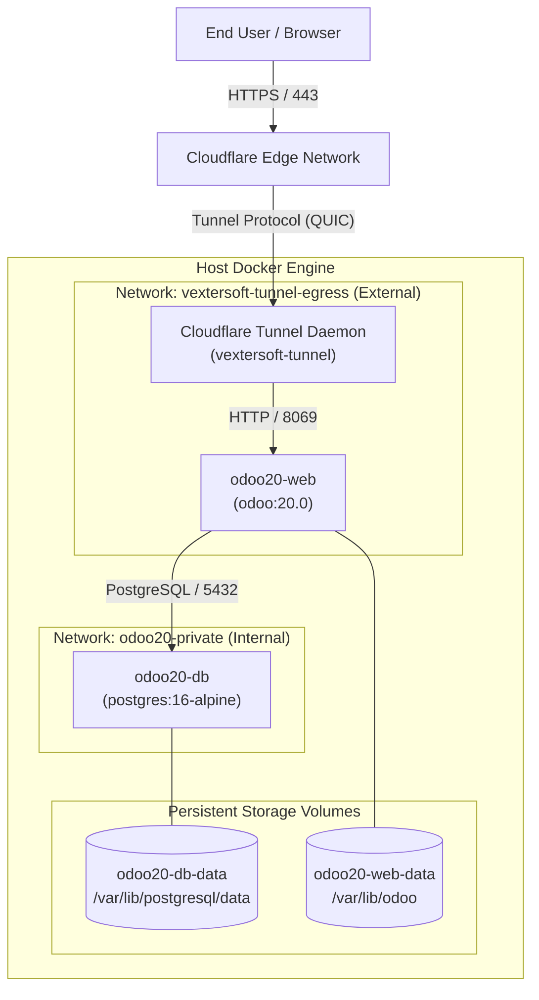

# Dependency Map

### Component Dependencies
1. **`CFTunnel` depends on Cloudflare Edge**: Establishes outbound persistent tunnel connection to Cloudflare PoPs.
2. **`odoo20-web` depends on `odoo20-db`**: Strictly sequenced with `service_healthy` condition on `pg_isready`.
3. **`odoo20-web` depends on `vextersoft-tunnel-egress`**: Network must be created beforehand on the host Docker engine (`docker network create vextersoft-tunnel-egress`).
